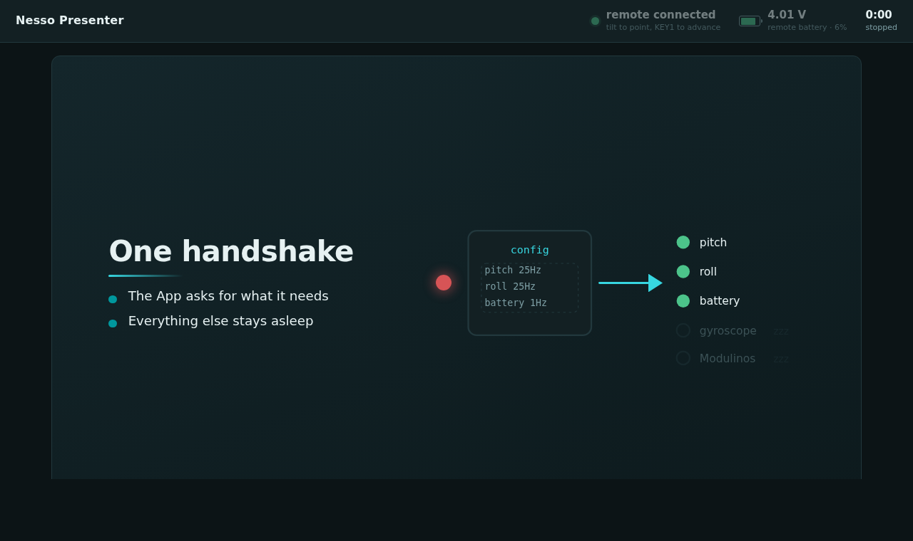

# Nesso Presenter

Phase 2. An Arduino App that turns an **Arduino Nesso N1** into a presentation
remote: its keys change slide, tilting it moves a pointer, and its screen carries
a jump control and the running clock.



It is a **separate App** from `nesso-companion` on purpose. The companion App is
a demo that registers everything the brick can do; this one is a real use case
that registers almost nothing — and that contrast is the point.

## What it asks the Nesso for

```
handshake sent: 4 sensor(s), 2 button(s), 0 modulino(s), 6 widget(s)
```

Four values: `pitch`, `roll`, `batteryVoltage`, `batteryLevel`. The
accelerometer, the gyroscope and every Modulino stay **asleep**, because nothing
here registered them. The companion App asks for ten sensors and five Modulinos
from the same firmware.

## Controls

| On the Nesso | |
| --- | --- |
| **KEY1** | next slide |
| **KEY2** | previous slide |
| **hold KEY1** | blank the screen |
| **hold KEY2** | recentre the pointer |
| Tilt | moves the pointer |
| `Jump` | go to any slide |
| `Pointer`, `Sensitivity` | pointer on/off, and how far a tilt travels |

| In the browser | |
| --- | --- |
| `←` `→` `space` `PageUp/Down` | change slide |
| `b` | blank |
| `p` | pointer |
| `f` | fullscreen |
| `r` | recentre the pointer |

Whichever side you touch, the other follows: the Nesso's screen shows the slide
number and clock, and its `Jump` stepper tracks the browser.

## What the UI shows, and why

The three readouts across the top are the things worth glancing at mid-talk:

- **Remote connected** — a dead remote mid-presentation is the failure that
  matters, so it is a dot and a sentence, not a buried status.
- **Battery voltage** — in **volts**, because the Nesso's fuel gauge is not
  calibrated and its percentage is not trustworthy (it has read 8% at 3.85 V, on
  a cell that is flat at 3.3 V and full at 4.2 V). The percentage is shown
  alongside, small. Below 3.55 V the readout turns red.
- **Clock** — elapsed time, start/pause/reset, mirrored onto the Nesso's screen.

Plus the classic presenter affordance: **up next**, so you know what is coming
without turning round.

If the App stops sending, the readouts dim rather than leave a stale number
looking live.

## The deck

`assets/slides.md`. Slides are separated by a line of `---`:

```markdown
# Slide title

> One line that carries the slide.
- a bullet, with **emphasis**
```

| Line | Becomes |
| --- | --- |
| `# text` | the title, with an accent rule under it |
| `` | the illustration — one per slide, and it splits the layout in two |
| `> text` | a lead line, larger and in full white |
| `- text` | a bullet |
| anything else | a muted paragraph |

Deliberately not a Markdown parser: that table is the whole grammar, which keeps
the deck editable by hand. Slide text is HTML-escaped before `**bold**` is
applied, since the deck is a file anyone can edit. It is read once at start-up,
so restart the App after editing.

### The illustrations

`assets/img/slides/*.svg`, hand-authored rather than stock images: they stay
crisp at any projector size, cost a couple of kilobytes each, carry no licensing,
and — being drawn for the slide — can show the actual mechanism instead of
decorating it. They share the App's palette, so a theme change is a find and
replace.

A slide with an illustration puts words on the left and the figure on the right;
without one, the words take the whole stage. On a portrait screen the split
stacks instead.

## Run it

```bash
arduino-app-cli app start user:nesso-presenter
```

Web UI on `http://<board-ip>:7000`, companion endpoint on `8077`.

> **Run one companion App at a time.** This App and `nesso-companion` both bind
> port 8077, and a Nesso can only link to one board at a time anyway. Using the
> same port is deliberate: switching Apps needs no reconfiguration on the Nesso.

## Notes

- The `nesso_companion` brick is **copied** into `bricks/`, because Custom Bricks
  live inside the App that uses them. A second consumer is the point at which it
  is worth publishing properly rather than copying — until then, changes have to
  be applied in both Apps.
- The pointer uses `pitch`/`roll` rather than raw acceleration: they are already
  gravity-referenced, so they hold still when the hand does. Smoothing is applied
  in Python, so the CSS deliberately has no transition on the pointer that would
  fight it.
- If the pointer moves the wrong way, the two signs are in `update_pointer()` in
  `python/main.py`; the Nesso's orientation in the hand decides them.
