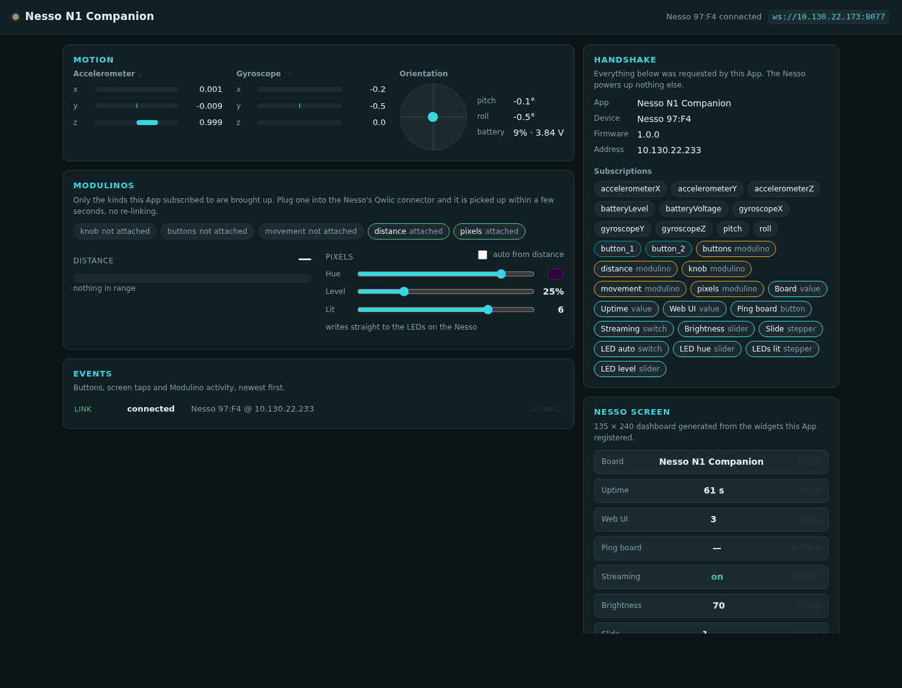
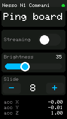

# Nesso N1 Companion

Two Arduino Apps for the **UNO Q** that use an **Arduino Nesso N1** as a
companion device, through one shared Custom Brick.

| | |
| --- | --- |
| [`apps/nesso-companion`](apps/nesso-companion) | The reference App. Subscribes to everything the Nesso can report and mirrors it on a live Web UI. Start here. |
| [`apps/nesso-presenter`](apps/nesso-presenter) | A slide deck driven from the Nesso: keys change slide, tilt moves a pointer, and two slides are live. |

Looking for something to download rather than a repo to work in? Two branches
hold trimmed copies, the ones published on Project Hub:

| | |
| --- | --- |
| [`projecthub/brick`](https://github.com/balsick/nesson1-applab-companion/tree/projecthub/brick) | The Custom Brick on its own, with the Nesso firmware ready to flash and the sketch sources inside it. |
| [`projecthub/app-export`](https://github.com/balsick/nesson1-applab-companion/tree/projecthub/app-export) | The `nesso-companion` App exactly as App Lab exports it, ready to import. |

## Install

Clone anywhere — **not** inside `~/ArduinoApps` — then:

```bash
./install.sh
```

App Lab discovers Apps by a flat scan of `~/ArduinoApps`, so each App has to be
a top-level directory there. `install.sh` symlinks them into place and copies
the brick into each one. Docker resolves the symlink when it bind-mounts the
App, so inside the container `/app` is an ordinary directory — which means you
edit the repo and the running App sees it, with nothing to copy back.

**Re-run it after changing `bricks/`**, because each App holds a copy. There is
no shared location for Custom Bricks in App Lab; keeping one source here and
copying at install time is what stops the two copies drifting apart in silence.
`./install.sh --check` reports without changing anything.

Then flash the Nesso — see [`nesso-firmware/README.md`](nesso-firmware/README.md),
which opens with the four libraries you need.

The Nesso finds the board on the network by itself, asks what it should do, and
then does only that: streams the sensor values the App subscribed to, at the
rates the App asked for, reports the buttons the App cares about, and draws a
dashboard generated from the widgets the App declared.



<p>
  
  
  
</p>

On the Nesso: the setup screen, whose QR joins the Nesso's own access point
straight from a phone camera; the board picker, which lists boards running a
companion App first with a green dot and dims the rest; and the dashboard
generated from the widgets this App registered.

### Changing the Wi-Fi network

Three ways, depending on what you have to hand:

| | |
| --- | --- |
| On the device | In the board picker, **hold KEY2**. Setup re-opens with the QR code, and the stored network is kept until you save a new one. |
| Over USB | `python3 tools/nesso_console.py portal` to re-open setup, or `"wifi <ssid> <password>"` to switch straight over. |
| Start clean | `python3 tools/nesso_console.py forget`, or hold **both keys while powering on**, which wipes the stored network entirely. |

## Layout

Everything shared lives at the root; everything App-specific lives under `apps/`.

```
nesso-companion/
├── install.sh                   # symlink the Apps into ~/ArduinoApps, copy the brick
├── bricks/nesso_companion/      # THE CUSTOM BRICK, single source  (see its README for the API)
├── nesso-firmware/              # THE NESSO SKETCH, one for both Apps  (build + flash)
├── tools/                       # fake_nesso.py (simulator), nesso_console.py,
│                                #   nesso_screenshot.py, nesso_serial.py
└── apps/
    ├── nesso-companion/
    │   ├── app.yaml             # web_ui + the nesso_companion brick (port 8077)
    │   ├── python/main.py       # registers every callback, mirrors to the Web UI
    │   ├── assets/              # the Web UI
    │   └── bricks/              # generated by install.sh - gitignored
    └── nesso-presenter/
        ├── app.yaml
        ├── python/main.py       # the deck, the pointer, the live slides
        ├── assets/slides.md     # the deck itself, in a tiny markdown dialect
        └── bricks/              # generated by install.sh - gitignored
```

The same firmware serves both Apps without reflashing: the Nesso renders
whatever the App it linked to declared in the handshake. That is the point of
the brick, and the presenter was written without touching the sketch.

## Run it

```bash
arduino-app-cli app start user:nesso-companion
```

- Web UI: `http://<board-ip>:7000`
- Companion endpoint: `ws://<board-ip>:8077` (descriptor at `http://<board-ip>:8077/info`)

### Pair the Nesso

1. Flash the firmware — see [`nesso-firmware/README.md`](nesso-firmware/README.md).
   It needs four libraries installed first, and the WebSockets one has a
   same-named impostor in the Library Manager; that README opens with the list.
2. Get it onto **the network the UNO Q is on**, either way:
   - **Over the USB cable**, which is already connected:
     ```bash
     python3 tools/nesso_console.py "wifi <your-ssid> <your-password>"
     ```
   - **From a phone**: on first boot the Nesso shows a QR code. Point a camera
     at it to join its `Nesso-N1-Setup` access point, then open
     `http://192.168.4.1`, pick the network and save.
3. The Nesso scans for Arduino boards and lists them. Boards running a companion
   App carry a green dot and show the App name. Tap one, or use KEY1 to move and
   KEY2 to select.
4. The Web UI turns green and the Nesso starts streaming.

> The Nesso discovers the board over mDNS, so **both have to be on the same
> network segment**. If the board is on a different subnet with no mDNS
> forwarding (a wired board and a separate Wi-Fi, say), the picker comes up
> empty.

### Testing the Modulino callbacks

The reference App subscribes to four: `knob/press`, `knob/rotate`, all `buttons` events
and all `movement` events. With nothing plugged in they simply stay quiet, and
the Nesso reports them absent.

- **With hardware:** plug a Modulino Knob, Buttons, Movement or Distance into
  the Nesso's Qwiic connector. It is picked up within ~3 s without re-linking; watch the
  Events panel in the Web UI. `python3 tools/nesso_console.py status` shows what
  the Nesso currently sees.
- **Without hardware:** `tools/fake_nesso.py` sends Modulino frames, so the
  App-side callbacks and the Web UI can be exercised on their own.

**Modulino Pixels is writable from either end.** `LED auto` follows the Distance
sensor as a proximity bar; turning it off hands control to `LED hue` and
`LEDs lit`. `LED level` sets brightness and applies in both modes - the LEDs are
uncomfortably bright at full output, so it defaults to 25%. All four exist both
as widgets on the Nesso's screen and as controls in the Web UI. Whichever one you touch, the other follows: a change from the
browser is pushed back onto the Nesso's widgets, so the screen never disagrees
with what the LEDs are doing.

`GET /api/pixels/test` runs a sweep across the eight LEDs, which is the quickest
way to confirm the output path end to end.

### Try it without a Nesso

```bash
python3 tools/fake_nesso.py ws://<board-ip>:8077/nesso
```

Run it from any machine on the network with `websockets` installed. It prints the handshake the App sent, then drives every callback path. The Web
UI reacts exactly as it would to real hardware.

## What the reference App registers

Everything the brick can do, so that the Web UI can show the full picture:

| | |
| --- | --- |
| Sensors | accelerometer X/Y/Z and gyroscope X/Y/Z at 20 Hz, pitch/roll at 10 Hz, battery level/voltage at 1 Hz |
| Buttons | `button_1` and `button_2`, all actions |
| Modulinos | `knob/press`, `knob/rotate`, all `buttons` events, all `movement` events, `distance` in mm |
| Modulino output | a Modulino **Pixels**, writable three ways: automatically as a proximity bar from Distance, from the Nesso's own screen, or from the Web UI |
| Screen widgets | `board`, `uptime`, `browsers` (read-only); `ping` (button), `stream` (switch), `brightness` (slider), `slide` (stepper); plus `LED auto` (switch), `LED hue` (slider) and `LEDs lit` (stepper) driving the Modulino Pixels |

The Web UI has four panels: the **handshake** the board sent, live **motion**,
a mirror of the **Nesso screen**, and an **event log** of every button, tap and
Modulino event.

The `ping` button is the round trip made visible: tapping it on the Nesso calls
a Python handler, which calls `send_value("board", "pong")`, which lands back on
the Nesso's screen.

## Updating the Nesso from the App

The brick can check a Nesso plugged into the board's USB at start-up and flash
it when its firmware differs from the one in the repo: 21 s to update an
out-of-date Nesso, 0.75 s to confirm a current one, on a background thread so
start-up never waits. It is **off by default** (`NESSO_AUTOFLASH: "false"` in
`app.yaml`), because probing resets whatever ESP32 is on the port and the USB ids
(`303a:1001`) cannot tell a Nesso from any other Espressif board. The details
are in the [brick README](bricks/nesso_companion/README.md#updating-the-nesso-from-the-app).

## Notes

- `python/requirements.txt` is deliberately empty: the brick declares its own
  dependency (`websockets`) in `bricks/nesso_companion/requirements.txt`, which
  the orchestrator installs into the App's venv.
- The companion port, 8077, is exposed by the brick itself (`ports:` in its
  `brick_config.yaml`), so the Apps do **not** list it in their own `ports:`:
  since App Lab 0.14 a port declared twice stops the App from starting. To move
  it, change `NESSO_PORT` in `app.yaml`, add the new port to that App's
  `ports:`, and set the same port on the Nesso from the setup portal.
- Third-party JS is vendored under `assets/js/vendor/`; no CDN is used at
  runtime.
- `GET /api/state` returns the whole link state, including the last value of
  every subscribed sensor. Handy for scripting and for checking the link without
  opening a browser.
- The Nesso cannot really charge while running: it draws more than the USB port
  supplies, so the battery drains slowly even when plugged in. The screen blanks
  after `NESSO_SCREEN_IDLE_S` seconds (60 by default) to limit that.
