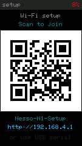
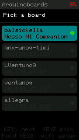

# Nesso N1 Companion

An Arduino App for the **UNO Q** that uses an **Arduino Nesso N1** as a
companion device, through a Custom Brick.

The Nesso finds the board on the network by itself, asks what it should do, and
then does only that: streams the sensor values the App subscribed to, at the
rates the App asked for, reports the buttons the App cares about, and draws a
dashboard generated from the widgets the App declared.


<p>
  
  
  
</p>

On the Nesso: the setup screen, whose QR joins the Nesso's own access point
straight from a phone camera; the board picker, which lists boards running a
companion App first with a green dot and dims the rest; and the dashboard
generated from the widgets this App registered.

### Changing the Wi-Fi network

Three ways, depending on what you have to hand:

| | |
| --- | --- |
| On the device | In the board picker, **hold KEY2**. Setup re-opens with the QR code, and the stored network is kept until you save a new one. |
| Over USB | `python3 tools/nesso_console.py portal` to re-open setup, or `"wifi <ssid> <password>"` to switch straight over. |
| Start clean | `python3 tools/nesso_console.py forget`, or hold **both keys while powering on**, which wipes the stored network entirely. |

## Layout

```
nesso-companion/
├── app.yaml                     # declares web_ui + the nesso_companion brick, port 8077
├── bricks/nesso_companion/      # THE CUSTOM BRICK  (see its README for the API)
├── python/main.py               # Phase 1: registers every callback, mirrors to the Web UI
├── assets/                      # the Web UI
├── nesso-firmware/              # THE NESSO SKETCH   (see its README for build + flash)
└── tools/                       # fake_nesso.py (simulator), nesso_console.py,
                                 #   nesso_screenshot.py, nesso_serial.py
```

## Run it

```bash
arduino-app-cli app start user:nesso-companion
```

- Web UI: `http://<board-ip>:7000`
- Companion endpoint: `ws://<board-ip>:8077` (descriptor at `http://<board-ip>:8077/info`)

### Pair the Nesso

1. Flash the firmware — see [`nesso-firmware/README.md`](nesso-firmware/README.md).
2. Get it onto **the network the UNO Q is on** (`Arduinoboards` here), either way:
   - **Over the USB cable**, which is already connected:
     ```bash
     python3 tools/nesso_console.py "wifi Arduinoboards <your-password>"
     ```
   - **From a phone**: on first boot the Nesso shows a QR code. Point a camera
     at it to join its `Nesso-N1-Setup` access point, then open
     `http://192.168.4.1`, pick the network and save.
3. The Nesso scans for Arduino boards and lists them. Boards running a companion
   App carry a green dot and show the App name. Tap one, or use KEY1 to move and
   KEY2 to select.
4. The Web UI turns green and the Nesso starts streaming.

> The Nesso discovers the board over mDNS, so **both have to be on the same
> network segment**. This UNO Q is reachable at `10.130.22.173` over Ethernet; if
> your Wi-Fi is a different subnet with no mDNS forwarding, the picker will come
> up empty.

### Testing the Modulino callbacks

Phase 1 subscribes to three: `knob/press`, `knob/rotate`, all `buttons` events
and all `movement` events. With nothing plugged in they simply stay quiet, and
the Nesso reports them absent.

- **With hardware:** plug a Modulino Knob, Buttons, Movement or Distance into
  the Nesso's Qwiic connector. It is picked up within ~3 s without re-linking; watch the
  Events panel in the Web UI. `python3 tools/nesso_console.py status` shows what
  the Nesso currently sees.
- **Without hardware:** `tools/fake_nesso.py` sends Modulino frames, so the
  App-side callbacks and the Web UI can be exercised on their own.

**Modulino Pixels is writable from either end.** `LED auto` follows the Distance
sensor as a proximity bar; turning it off hands control to `LED hue` and
`LEDs lit`. `LED level` sets brightness and applies in both modes - the LEDs are
uncomfortably bright at full output, so it defaults to 25%. All four exist both
as widgets on the Nesso's screen and as controls in the Web UI. Whichever one you touch, the other follows: a change from the
browser is pushed back onto the Nesso's widgets, so the screen never disagrees
with what the LEDs are doing.

`GET /api/pixels/test` runs a sweep across the eight LEDs, which is the quickest
way to confirm the output path end to end.

### Try it without a Nesso

```bash
docker exec nesso-companion-main-1 \
    /app/.cache/.venv/bin/python /app/tools/fake_nesso.py
```

It prints the handshake the App sent, then drives every callback path. The Web
UI reacts exactly as it would to real hardware.

## What Phase 1 registers

Everything the brick can do, so that the Web UI can show the full picture:

| | |
| --- | --- |
| Sensors | accelerometer X/Y/Z and gyroscope X/Y/Z at 20 Hz, pitch/roll at 10 Hz, battery level/voltage at 1 Hz |
| Buttons | `button_1` and `button_2`, all actions |
| Modulinos | `knob/press`, `knob/rotate`, all `buttons` events, all `movement` events, `distance` in mm |
| Modulino output | a Modulino **Pixels**, writable three ways: automatically as a proximity bar from Distance, from the Nesso's own screen, or from the Web UI |
| Screen widgets | `board`, `uptime`, `browsers` (read-only); `ping` (button), `stream` (switch), `brightness` (slider), `slide` (stepper); plus `LED auto` (switch), `LED hue` (slider) and `LEDs lit` (stepper) driving the Modulino Pixels |

The Web UI has four panels: the **handshake** the board sent, live **motion**,
a mirror of the **Nesso screen**, and an **event log** of every button, tap and
Modulino event.

The `ping` button is the round trip made visible: tapping it on the Nesso calls
a Python handler, which calls `send_value("board", "pong")`, which lands back on
the Nesso's screen.

## Where the phases go next

Phase 1 is the one that is built. The brick and the firmware already carry what
the rest needs:

- **Phase 2 — presentation remote.** `on("button_1")` → next slide,
  `on("button_2")` → previous, `on("accelerometerX"/"Y")` → move a cursor. Add a
  slide deck to the Web UI and a `slide` stepper on the Nesso screen (already
  registered here) so the Nesso can jump around too.
- **Phase 3 — Modulino Pixels.** Plug a Modulino Pixels into the Nesso's Qwiic
  connector and call `companion.send_modulino("pixels", [(r, g, b)] * 8)`. The
  outbound path and the firmware handler both exist; it needs the hardware to
  verify.
- **Phase 4 — to be defined.**

## Notes

- `python/requirements.txt` is deliberately empty: the brick declares its own
  dependency (`websockets`) in `bricks/nesso_companion/requirements.txt`, which
  the orchestrator installs into the App's venv.
- The companion port appears in three places and they must agree: `ports:` and
  the `NESSO_PORT` variable in `app.yaml`, and the port stored on the Nesso
  (default 8077, changeable from the setup portal).
- Third-party JS is vendored under `assets/js/vendor/`; no CDN is used at
  runtime.
- `GET /api/state` returns the whole link state, including the last value of
  every subscribed sensor. Handy for scripting and for checking the link without
  opening a browser.
- The Nesso's battery was at 8% during testing. It charges over USB-C whenever
  it is plugged in, and the firmware enables charging at boot.
