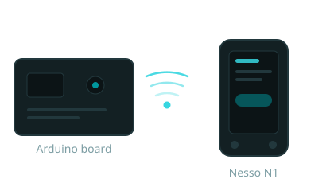
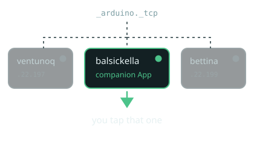
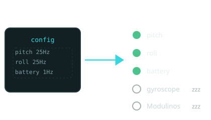
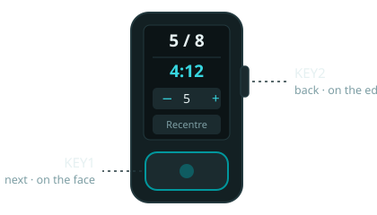
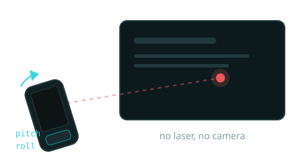
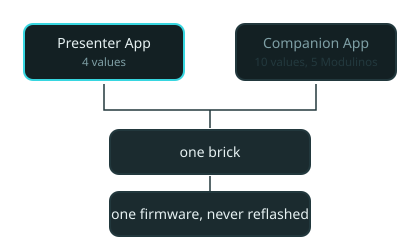
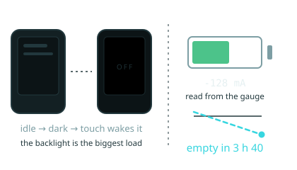

# Nesso N1 Companion
> A second screen and a remote, over a WebSocket.


---

# It finds the board itself

- mDNS lists every Arduino board on the network
- We then ask each one whether the companion brick answers on its port
> Only the boards actually running it get a green dot. You tap one.

---

# The App says what it needs

```python
companion.on("pitch", move_pointer)
companion.on("button_1", next_slide)
companion.on_value("slide", "stepper", jump)
```
- Registering a callback on the brick **is** the request
- The whole list crosses once, as the handshake
> Anything nobody registered never wakes up.

---

# The remote

- **KEY1**, the big one on the face: press forward, **double-press** back
- **Hold KEY1**: the browser sheds its chrome and the slide fills the window
- **KEY2**, on the edge: recentre the pointer — findable without looking
> Six widgets on its screen, drawn from what this App declared: jump, clock, sensitivity.

---

# The pointer is just the IMU

- pitch and roll leave the Nesso 25 times a second
- Smoothed in Python, because hands shake
> That red dot is the tilt of the remote in my hand. Right now.

---

# Plug a Modulino in
!live pixels
- The Nesso re-probes for missing modules every three seconds
- Nothing here was configured for it in advance
> Plug the Pixels in now. The strip below is the real one.

---

# Same firmware, different App

- This deck asks for four values and one Modulino
- The companion demo asks for ten values and five Modulinos
- Every callback names the Nesso it came from, so one App can hold several at once
> Neither ever reflashed the Nesso. It renders what it is told.

---

# What it could do next

- Already running: the screen blanks after **120 s** and wakes on touch — the App sets that
- The backlight is only on/off through the expander, so dimming is the next step
- The gauge reports **current**, not just charge, so runtime is arithmetic
> Then the handshake could quote its own price: what this subscription costs you, in minutes.

---

# This talk, measured
!live credits
> Not written down in advance. Read off the link, just now.
