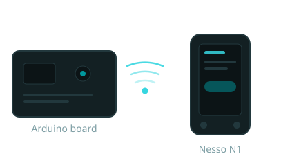
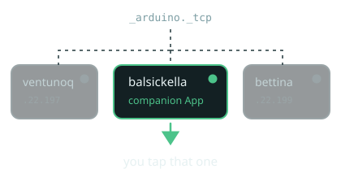
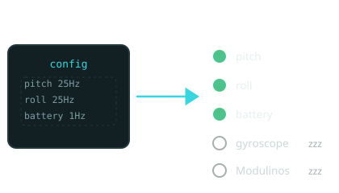
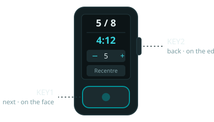
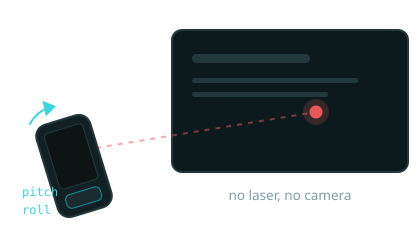
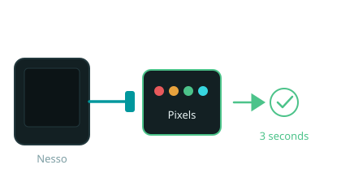
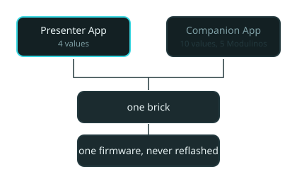

# Nesso N1 Companion
> A second screen and a remote, over a WebSocket.

---

# It finds you

> No addresses to type.

---

# One handshake

- The App asks for what it needs
- Everything else stays asleep

---

# This is the remote

- **KEY1** next, **KEY2** back
- Hold to blank, or recentre

---

# Point at it

> Tilt. The dot follows.

---

# Plug it in

> Found in three seconds. No re-linking.

---

# Same firmware

> Two Apps. One brick. Nothing reflashed.
